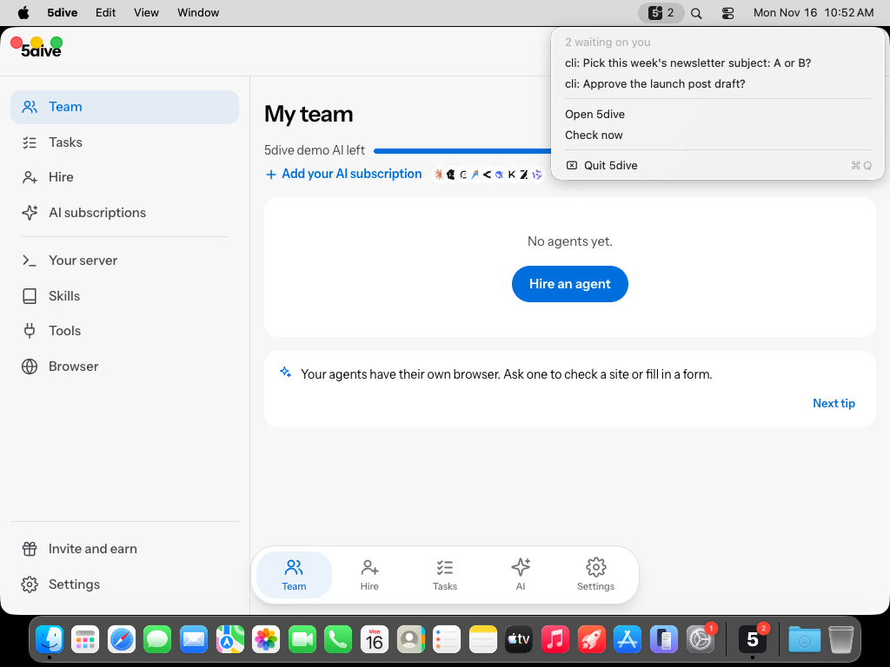

# 5dive for Mac

Your AI team in its own Mac window. The menu bar shows when an agent needs you.

**[Download 5dive.dmg](https://github.com/5dive-ai/5dive/releases/latest/download/5dive.dmg)** · macOS 12 or newer · Apple Silicon and Intel · free and open source (MIT)



## What it does

- Opens [5dive.app](https://5dive.app) in its own window and keeps you signed in.
- The menu-bar icon gets a dot and a number when an agent is waiting on you (a decision, an approval, a key). Click a line to open that task.
- A Mac notification when a new one arrives, and the same number on the Dock icon.
- Closing the window keeps the icon running. Quit from the icon's menu.

## First launch

The app is not notarized by Apple yet, so macOS asks once. Open the .dmg, drag 5dive to Applications, open it, then go to **System Settings → Privacy & Security** and click **Open Anyway**.

## Build it yourself

```sh
npm ci
npm start        # run it
npm test         # unit tests
npm run dist     # build dist/5dive.dmg (on a Mac)
```

Every tag `v*` builds the .dmg on a Mac in GitHub Actions, opens it once as a check, and attaches it to the release here. Downloads are served from the main repo, [5dive-ai/5dive](https://github.com/5dive-ai/5dive/releases/latest): its `mac-app-mirror` workflow copies this repo's latest `5dive.dmg` onto its Latest release within the hour. This repo stays the source.

## Privacy

The app is the 5dive web page plus a menu-bar icon. It keeps no token of its own: once a minute it asks the signed-in page the same "who needs me" question the web app's Needs-you badge asks. Nothing else is sent anywhere.

## License

[MIT](LICENSE)
